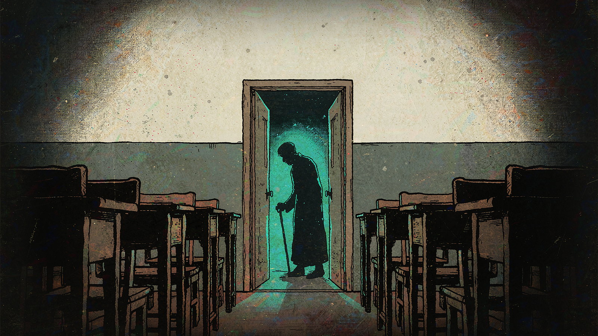
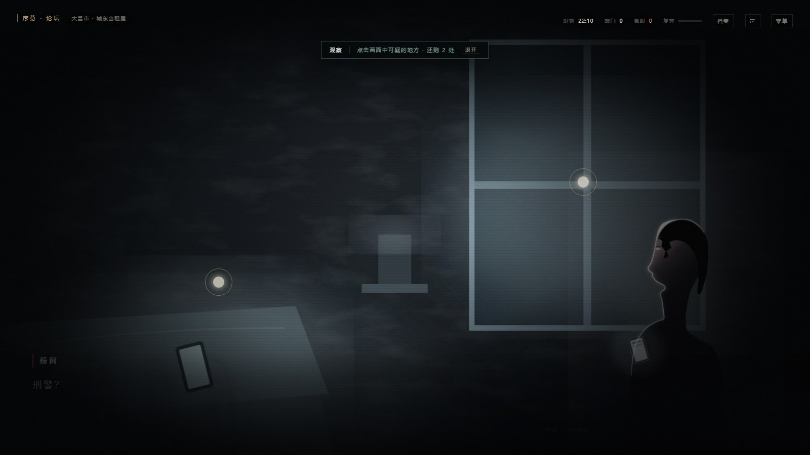

# 恐怖复苏 · 敲门

> 一段被敲门声打断的晚自习。
> 改编自佛前献花《恐怖复苏》第一卷（第 1—20 章），一款可离线运行的交互式剧情游戏。



**游戏内截图**



> 观察模式：画面变暗，可细看的地方会浮出光圈；看过的内容写进档案。

---

## 一、这是什么

2024 年 6 月 21 日，大昌市第七中学，高三（二）班。

晚自习临时改成"安全宣传课"，来讲课的国际刑警在黑板上写下三句话：

> 鬼无法被杀死。
> 能对付鬼的只有鬼。
> 洞察鬼的规律。

二十分钟后，教室的灯灭了。走廊上站着一个穿黑色长衫的老人。
他抬起手，在门上敲了三下。

**咚——咚咚。**

你会成为杨间，在接下来的七个小时里：判断哪扇门能开、哪句话能信、哪个人值得救，以及——要不要用自己的眼睛，去换一条活路。

- 约 **1.85 万字** 剧情文本，**104 个场景节点**（含 `k13` 那扇最后一道门、3 个 fail-forward 分支 `ff_c2b` / `ff_d4stop` / `f11b`，以及理智断片节点 `sanityBreak`）
- **7 个结局**，**42 条档案**（24 条线索 + 5 鬼物 + 7 人物 + 6 记忆碎片，全部可在游戏中解锁）
- **三档难易度**（故事 / 标准 / 噩梦）：每看一处要花 4 / 6 / 8 分钟——代价倍率、提示强度、存档规则、死亡惩罚都不同
- 全程序化音效与配乐（WebAudio 实时合成，无音频文件）
- 纯前端、零依赖、可离线，双击即玩
- 自带 **156 项自动化测试**（真实引擎 + 最小 DOM，含结局可达性穷举证明）

---

## 二、快速开始

**方式一：直接打开**

双击 `index.html`。推荐 Edge / Chrome / Firefox 最新版。

> 浏览器对本地文件的限制不同，若字体或声音异常，可用方式二。

**方式二：本地静态服务器（可选）**

```bash
# 在项目根目录
python -m http.server 8000
# 然后访问 http://localhost:8000
```

无需安装依赖、无需构建。

**建议**：戴耳机，关灯，把浏览器缩放保持在 100%。

---

## 三、操作

| 操作 | 按键 / 鼠标 |
|---|---|
| 推进对话 | `空格` / `回车` / 点击画面 |
| 选择选项 | 点击，或按 `1`—`9` |
| 观察四周 | 选项中的「观察四周」，或按 `O` |
| 打开档案 | `C`，或右上角「档案」 |
| 声音开关 | `M`，或右上角「声」 |
| 暂停菜单 | `Esc` |
| 跳过打字 | 点击画面 / `空格` |

进度在**每次进入新场景时自动保存**；暂停菜单里也可以手动保存、读取。
「设定」里可以调节**难易度**、音量、文字速度、减少动效、清除进度。
「观察四周」旁边会写清这一档看一处要付什么代价。

> 难易度会写进存档、跟着这一局走：在设定里改会**立刻生效**，同时成为下一局的默认值。具体规则见第四节第 9 小节。

---

## 四、系统说明

### 1. 观察与线索

每个场景里都有可以细看的地方（画面上的光圈）。点击「观察四周」进入观察模式，把可疑之处看一遍，会记录进**档案 · 线索**。

部分选项需要特定线索才会解锁。比如：

- 想对周正喊出"是敲门声"，你得先自己想明白敲门声在计时；
- 想在最后一刻张开鬼域，你得知道"眼睛的数量"意味着什么。

观察不是必须的，但它决定了你能看见多少条活路。

看完一处**不会**被踢出观察：光圈会重新排布，提示条上的"还剩 N 处"同步更新；把所有可疑之处看完（或随时点「退开」）才会回到选项。已看过的点不会重复出现。

**光圈是分级的**，让你一眼判断哪一处值得花那 5% 电：

| 光圈 | 形状 | 含义 |
|---|---|---|
| **青色（更大）** | 圆点 | 关键线索：看了能解锁某个选项 |
| **金色** | 菱形 | 档案 / 记忆碎片 |
| **灰白（更小）** | 小方块 | 氛围细节 |

形状是刻意加的：颜色不是所有人都分得清，形状是。

分级不是手写的：引擎在启动时扫描全部剧情的选项条件，反推出"哪些线索是被需要的"，
再和热点给的线索对照（`hotspotTier()`）。改剧情不用改配色，分级会自己跟上。

**但"看"是要付代价的**——低头细看要花时间，手里的灯要耗电：

| 每看一处 | 故事 | 标准 | 噩梦 |
|---|---|---|---|
| 时刻 | **+4 分钟** | **+6 分钟** | **+8 分钟** |
| 敲门 | 每 2 处 +1 | **+1** | **+2** |
| 电量（照明费） | **−3%** | **−5%** | **−7%** |

代价不是装饰，它真的会咬人：

- **电量见底 = 手机没电**。厕所里那段"救命录音"（能烫退惨白手掌、也是唯一能救段鹏的办法）需要手机还活着。
  到了厕所手机断电，你就只能靠白骨树那边的一点红光活下来。想看，就得挑。
- **电量不够时，你可以用"眼睛"看**：`eyes ≥ 1` 时，看一处不再扣电，改成扣复苏（`light:1` +3 / `light:2` +5）。
  只有"一只眼睛都没有"的时候，光圈才会真的变灰、点不开（这时提示会写「2 处太黑，得先有眼睛」）。
- **复苏过了 30 之后，近处的东西由眼睛替你照着**，不再耗电——人味越少，看得越清楚。
- 有些点写在旁白里不用照明（鬼眼、发光物、晨光，`light: 0`），它们一分钱不收。
- 盯着不该看的东西要额外记账：`risk` 越高的点，多听几次敲门（最高 +3）。
- **敲门累计到阈值**（标准 13 / 噩梦 11）：会被拖进 `k13`「敲门声停在第十三下」——噩梦档直接判死。
- 关键线索并不贵：`knock_rule`（"是敲门声"那句话的前提）在 `p14` 或 `p16` 任一节点看一处就能拿到。

> 时间也不是白走的：**每读过一个节点都要扣基础耗时**（故事 3 / 标准 4 / 噩梦 5 分钟），
> 三点之后敲门开始自己增长，五点三十到点就会被拖进死线。

### 2. 鬼眼与复苏

杨间的身体里会睁开红色的眼睛。眼睛越多，能看破的黑暗越多，能做的事也越多——但每用一次，那只鬼就复苏一分。

- **鬼眼**：右上角计数。
- **复苏**：右上角细条。累积到 60% 以上，终幕会多出一个"不该有"的选项。
- **电量**：手机掉到 100% 以下时，右上角会出现电量。它不只是氛围——**电量归零会让手机上的东西全部失效**
  （比如那段救命录音），而这正是"观察"要收的账。

### 3. 敲门

右上角的「敲门」记录你这一夜听见了多少次敲门声。

在原著里，敲门声是**坐标**：听过的人，会被找上门。游戏里它同样是一个会跟着你的数字——你听得越多，最后来找你的东西就越确定。

它不是只躺在 HUD 里的计数，而是**听得见、看得见地逼近**：

| 累计 | 表现 |
|---|---|
| 每看一眼观察点 | 喇叭里真的响一次"一长两短"（看得越多，听得越多） |
| 10 下以上 | 数字转成琥珀色；环境里开始每隔几秒有一次心跳；底层 drone 升高一档（43.65 → 48.6 Hz），呼吸变快 |
| 13 下以上 | 数字转为血色脉动、整屏浮起一层暗红；敲门声变成更沉、更慢的**近门版**（带门板被压出的呻吟）；drone 再升一档到 54.2 Hz、低通收紧、音量抬高；观察提示条会多一句"他已经站在门外了" |

终幕（`f9`）还有一段只在 13 下以上才出现的台词：

> 你忽然意识到，这一整夜你听见的敲门声，加起来早就超过了十三下。
> ——他一直不用找。你每一次抬头，都是在回答他。

所有音效都是实时合成的：普通敲门与"近门版"是同一套节奏，只改了低频、时长和一点木头呻吟。

### 4. 时刻

HUD 显示当前时刻，从 22:10 一直到 05:31。

原著里，教室的钟停在八点半，等他们逃到操场，时间已经是凌晨四点。游戏保留了这种"时间被偷走"的感觉：你每做一个决定，天就亮一点，或者永远不亮。

### 5. 理智

HUD 上没有它。你只能在跨档的那一刻听见自己的呼吸变了、看见画面边缘轻轻一抖，或者发现旁白里有个字写得不对。

- **范围**：100 起，0–100，开局满值。
- **不显示数值**：剧情里没有任何数字或条；想知道自己在哪一档，**去档案页看**——顶部写着当前档位名。

| 理智 | 档位 | 你能感觉到什么 |
|---|---|---|
| 80–100 | 清醒 | 无 |
| 60–79 | 动摇 | 呼吸声多一层；画面边缘极轻微横向抖动；档案级的观察点开始"看不清"（点得开，但不给线索） |
| 35–59 | 恍惚 | 旁白出现 1–2 处错字；有一句台词挂错了人（张伟的话被"老人"接了下去）；"更优解"开始消失（`p16` 的"它在计时"需 40、`d4` 屏息需 40、`f6` 串规则需 45） |
| 15–34 | 错乱 | 名字被写错；**多出一个幻觉选项**（很诱人，但更贵；标准档在错乱出现，噩梦档从恍惚就开始，故事档没有）；锁定提示开始说错原因 |
| 0 | 断片 | 黑屏 → 回到**刚才那一格** → 时间 +30 分 → 理智回到 40（噩梦只回 30；故事档不断片，只锁在 1）。每幕最多一次 |

**它和「复苏」是两条相反的账**：

| | 复苏 | 理智 |
|---|---|---|
| 收什么钱 | **动手**：碰鬼、睁眼、咬眼、借力、摸树 | **看懂**：看见不该看的、听见、想通、丢下人、在鬼域里睡着 |
| 走到头会怎样 | 变强（免电看暗处），直到幕末被判成鬼 | 变糊涂（做法降级、观察失真、出现幻觉选项），直到断片 |
| 会死吗 | 会（失控线） | **不会** |

全篇只有一处两条账一起收：`f10`「咬下那只眼睛」（复苏 +25 / 理智 −20）——吃自己的眼睛既是身体事件，也是精神事件。

**低理智不锁"能不能过"，只把"精确的做法"降级成"更贵的做法"**：

| 位置 | 清醒时 | 理智不足时 |
|---|---|---|
| `f2` 那通电话 | 「立刻挂断」（+5 理智） | 「把手机扔进黑里」——**照样给 `no_answer`**，多付 10% 电 / 6 分钟 |
| `f10` 五点三十 | 「咬下那只眼睛」 | 这一项消失，但「鬼域罩住所有人」「我跑得比他快」「闭上眼睛」都还在 |

**断片不判死**：黑屏之后回到触发断片的那个节点，时间 +30 分，理智回到 40（噩梦 30）。不扣同伴、不加敲门、不重走已经看过的段落——代价只有时间。故事档不触发断片：理智压在 1，只给一句旁白。

**三档差异**：

| | 故事 | 标准 | 噩梦 |
|---|---|---|---|
| 理智门槛 | **不锁任何选项** | 锁"更优解"（`p16`/`d4`/`f6`）、`f2` 降级、`f10` 咬眼需 ≥30 | 同标准，另加 `f8` 取纸需 ≥30 |
| 扣减 / 恢复 | **×0.5（最小 1）/ ×1.5** | ×1 / ×1 | **×1.25（向上取整）/ ×1** |
| 归零 | **不断片**：只锁在 1，加一句专属旁白 | 断片，理智回 **40** | 断片，理智回 **30** |
| 幻觉选项 | **没有** | 错乱（≤34）出现 | **恍惚（≤59）就出现** |
| 档案页的档位名 | 显示 | 显示 | **不显示**（连"我有多糊涂"都不告诉你） |

跨档的那句旁白，故事档也有自己的一套——走廊变长、有人在数数、手比你先动——不是标准档那三句的复用。

> **没有任何选项需要先通关才能选。** 三档的门槛都只来自局内状态——线索、道具、敲门、电量、理智。

**观察也会动它，而且方向是分叉的**：

- 看**冲击性**的东西扣理智，四处：赵强脖子上的手印、白骨树上的人皮、同学们背后多出来的那张脸、风衣底下鼓起来的肚子。
- 看**数得清**的东西回理智：水龙头、墙上的楼层号、苗小善的表、他走过的十二块地砖、卫星电话屏幕。

> 这条不只是平衡，是主题：能救你的不是"更懂鬼"，而是"还记得水龙头没关紧"。

### 6. 档案与结局回廊

- **档案**：线索、鬼物、人物、记忆碎片。看过的内容会永久解锁。
- **线索图**：线索页顶部是**主线推理链**——六步，从"声音是坐标"一路到"那张纸在撒谎"。
  线索齐了才点亮；没点亮的那一步会直接写出**还差哪一条**（例如"线索不足——还差：不能接的电话"）。
  每条线索下面还有"相关"跳转，点了会滚到对应线索并闪一下；没解锁的显示为 `？？？`。
- **结局回廊**：7 个结局，**每个结局都有一张插画**，通关一个点亮一个。
  没解锁的格子是一块斜线暗板；解锁后才显出画面与那句话。结局提示只给一句话，不剧透。

线索之间的连接写在 `js/data.js` 的 `links` 字段里，主链写在 `CLUE_CHAIN` 里——
都是数据，不用改渲染代码就能调整推理结构。

### 7. 存档

- **自动存档**：每进入一个节点就写入自动槽（单槽，会覆盖）。
- 结局、档案解锁、设定会单独保存，不受"新游戏"影响。
- **旧存档可以直接读**：存档带版本号，缺字段一律用默认值补齐；老版本的存档按「标准」档继续，
  数值与当初保存时一致。损坏的存档会被当作"没有存档"，不会崩。
- **读档时如果难度和设定不一致会先问你一句**，并且始终按存档里的档位继续——不会偷偷改掉存档的难度。

各档位的存档规则不同（这就是"选择的分量"）：

| | 故事 | 标准 | 噩梦 |
|---|---|---|---|
| 自动存档 | 每节点 | 每节点 | 每节点，覆盖 |
| 保存进度 / 读取进度 | **可用**（手动槽） | 移除 | 移除 |
| 回到开头 | 「回到本节点开头」（精确到节点） | 「回到本场景开头」（唯一回退，退一整段场景） | 移除 |
| 死在坏结局 | 不回滚（结局页可直接重开） | 回**本场景开头**，资源维持当时的数值（≤5 次） | 回**本场景开头**，**敲门 +3、同伴 −1**（≤3 次） |

「回到开头」会把资源一起退回锚点时的数值——它是"重试这一步/这一段"，不是"赦免"：
故事档退回**这个节点**，标准档退回**这个场景**（所以你没法在一句话之内反复撤销选择）。
回滚后引擎会立刻夹一次上限（敲门夹到"贴门"线 −1、复苏夹到失控线 −15），否则会"回滚→立刻再死"死循环。

### 8. 周目：重走这一夜

**通关过一次之后**，标题页会在「开始游戏」下面多出一项：

> **重走这一夜** —— 第 2 次走进这一夜

它**只做三件事**：

- **继承档案与线索图**（本来就存在永久解锁里，所以上一周目看过的规则这一周目直接可查）；
- 在结局统计行前面记上「第 N 次走进这一夜」——这是回执，不是内容；
- 给你一个重玩一遍的入口。

**它不再带来任何专属内容。** 早期版本里"多出几段只有走过一次才有的旁白""多出几个周目专属选项（第一次玩是灰的，提示写着『你要先逃出过一次』）"已经**全部删除**。
理由很直接：第一次游玩的人看到一排灰掉的选项，等于被告知"你现在玩的是残缺版"。

所以现在：

> **没有任何选项需要先通关才能选。**
> 所有门槛都只来自局内状态——线索、道具、敲门、电量、理智。

「**第二次的门**」这条记忆碎片也不再由周目解锁：它改在**理智断片**时获得——你在厕所或走廊断片、重新睁眼的那一刻。

新玩家看到的标题**仍然只有 5 项**——周目入口是通关后才动态加上的。

### 9. 难易度：三档代价

难易度**只改引擎参数，不改剧情**：哪句话被锁、哪个结局能到，永远由线索与旗标决定；
档位影响的只有"代价多重、提示多细、存档多严"。
实现上分两层：**观察代价**走倍率（故事 ×0.75 向下取整 / 标准 ×1 / 噩梦 ×1.25 向上取整），
所以那几行数字是算出来的；**节点耗时**读显式表 `nodeClock: {walk, run, still}`
（4/2/0 · 6/3/0 · 7/4/0，由节点的 `pace` 选择）——它**故意不乘倍率**，
因为 `6 × 1.25 = 7.5` 无论向上还是向下取整都会让噩梦档的时间预算失衡。

| | 故事 | 标准 | 噩梦 |
|---|---|---|---|
| 观察耗时 / 处 | 4 分 | 6 分 | 8 分 |
| 观察耗电 / 处 | 3% | 5% | 7% |
| 观察敲门 / 处 | 每 2 处 +1 | +1 | +2 |
| 节点基础耗时（序幕–三幕） | 4 分 | 6 分 | 7 分 |
| 节点耗时（四幕 `pace:'run'` / 终幕 `'still'`） | 2 / 0 分 | 3 / 0 分 | 4 / 0 分 |
| 敲门警告 / 危险 / `k13` | 10 / 13 / 不触发 | 9 / 12 / 13 | 8 / 10 / 11 |
| 用鬼眼照明（`light:1` / `light:2`） | 复苏 +2 / +3 | +3 / +5 | +5 / +8 |
| 手机照距（`light:2` 可用线） | 电量 ≥20% | ≥30% | ≥45% |
| 复苏失控线 | 95 | 85 | 75 |
| 危险选项的外显标记 | **保留一个**：数字圆点是干血红 | 无 | 无 |
| 锁定提示 | 明说缺什么 | 只说状态 | 只说"你做不到" |
| 手动存档 / 回退 | 可存可读可回退 | 只能回退到本节点开头 | 都不能 |

「标准」就是设计意图那一版：**你只能看一半，得挑**。

**资源后果一览：**

| 资源 | 后果 |
|---|---|
| **电量** | < 30% 画面转暗（`.low-battery`）；< 10% 更暗，而且能看清的观察点会变少——**只吞细节与档案，关键线索和标了 `noDim` 的点永不被吞**（砍掉唯一线索来源 = 卡关）。归零只给一句叙事提示，不直接判死。 |
| **鬼眼** | 电量不够时，`eyes ≥ 1` 可以"用这只眼睛看"（不扣电、扣复苏）；只有 `eyes === 0` 才会真的点不开。 |
| **敲门** | 到警告/危险线时画面发沉（`dread-lv1/2`）、音频换档；到 `k13` 线会被拖去「敲门声停在第十三下」——噩梦档在那一步直接判死。 |
| **时刻** | 每个节点扣基础耗时（4/6/7，四幕 2/3/4，终幕 0）；锚点只会用 `max` 往前推，不会时间倒流；跨 03:00 置"深夜"标记；到 05:30 强制进入死线节点。判断用**经过分钟数**，不是 `clock % 1440`。 |
| **复苏** | 阈值 −5 时 HUD 转血色并警告一次；到失控线且正处幕末 → 强制 `end_absorb`。另有一次「压住它」：消耗 1 名同伴把复苏压回 70（一局一次）。 |
| **理智** | 选择 / 观察都在动它，但不显示数值。跨档只给呼吸声、旁白与画面轻抖，档案页显示档位名。到 0 触发**断片**：回到触发断片的那个节点、时间 +30 分、理智回 40，每幕最多一次；**不判死、不扣同伴、不加敲门**。详见第四节第 5 小节。 |
| **`rotAfter`** | 到点后同一地点自动换 `_rot` 版本。当前剧情已全部改用它（10 个地点 / 22 处），手写的 `_rot` 场景名已清空。 |

归零钩子是引擎层的统一入口（`HOOKS.resourceEmpty`）：现在只写日志 + 给一句提示，
将来要在归零时做别的事（扣血、跳节点、开新结局），挂一个函数即可，不用改引擎。

---

## 五、剧情结构

游戏共七幕，对应原著第 1—20 章：

| 幕 | 标题 | 对应原著 | 核心 |
|---|---|---|---|
| 序幕 | 论坛里的鬼故事 | 第 1 章 | 帖子、照片、那段不该听的录音 |
| 第一幕 | 临时讲课 | 第 2—4 章 | 黑板三句话、鬼域降临、第一次死亡 |
| 第二幕 | 楼梯 | 第 5—7 章 | 鬼打墙、苏蕾之死、被推进厕所 |
| 第三幕 | 黑暗 | 第 6—8 章 | 惨白的手、敲门声退鬼、白骨树 |
| 第四幕 | 眼睛 | 第 8—11 章 | 鬼眼、周正之死、鬼婴、救不救王珊珊 |
| 第五幕 | 四点零五分 | 第 12—17 章 | 操场、138 来电、人皮纸、论坛的真相 |
| 终幕 | 五点三十一分 | 第 18—20 章 | 五点三十的死线、吞眼、张开鬼域 |
| 尾声 | 三天后 | 第 20 章之后 | 封校的第七中学、黑板上的三句话 |

### 七个人

原著第 19 章标题叫《离开的八人》，人皮纸也写着"一共八个"。

但正文写的是"等七人"，第 20 章写"多出了七个人"，后文杨间亲口说"我们一共只有七个人活了下来"。

**八，是人皮纸的谎话。**

游戏把这个谎话做成了结局之一。你可以自己去数。

### 序章的一个岔口：那段音频，你点不点

这不是装饰性的选择，它改变整条线的因果：

- **点开**：你听见了"一长两短"，被打上坐标。你手机里留下那段录音（厕所里能用两次，也能用它救段鹏），但那只鬼从一开始就是冲你来的。
- **不点**：你没有听见，所以诅咒没有落在你身上。被找上门的是张伟——他在教室里那句"算了，没什么"，要到校门口才说完。你没有录音可用，厕所里只能靠别的东西活下来。

两条线最后都会被五点三十的那通电话拖进同一个死局。这大概就是这本书里最不讲道理的地方：**你可以不做那件事，但你没法不在场。**

---

## 六、结局（含轻度触发提示）

<details>
<summary>点开查看结局名与触发方向（不剧透正文）</summary>

| # | 结局 | 触发方向 |
|---|---|---|
| 1 | 门后的第十三次 | 在黑暗里停下、等待、或转身面对它 |
| 2 | 永远的五楼 | 在楼梯间一直往下走 |
| 3 | 一个人走出校门 | 终幕丢下所有人，独自冲出去 |
| 4 | 成为鬼 | 复苏过高之后，在街头让所有眼睛睁开 |
| 5 | 第八个人 | 没有拉住王珊珊，却走到了最后 |
| 6 | 被写下的人 | 拿到人皮纸，并在终幕照它说的做 |
| 7 | 五点三十一分 | 救下该救的人，凑够眼睛，在死线前张开自己的鬼域 |

</details>

---

## 七、美术设计

所有美术资源都在 **`art/`** 一个文件夹里，共 **61 个文件**：
21 张场景 + 21 张 `_rot` + 11 张立绘 + 7 张结局 + 1 张封面。

### 风格

**1930s 复古橡皮管动画 · 恐怖。**

一句话：一张大萧条前的美国动画赛璐珞，被泡在 2000 年中国县城中学的福尔马林里。

- **墨线**：粗而不匀的手绘外轮廓（1024 宽基准下 10–14px）；起笔留墨结、收笔渐细、约 15% 的转角故意不闭合。闭合 = 矢量感 = 廉价。
- **平涂**：cel-ink 平涂，不做渐变；阴影用同色相降明（骨白→褐），网点只出现在明暗交界处。
- **脸**：派切眼（pie-cut），实心黑或白底一点瞳，不画睫毛、不画高光十字。
- **身体**：无肘无膝的橡皮管四肢、四指白手套、4.5–5 头身；单肩下沉，**不允许左右对称站姿**。
- **切边**：每张立绘的整体剪影外圈一条骨白切边。这既是风格理由（人物是从旧海报上剪下来的纸片木偶），也是暗场景里唯一保命的可读性装置——**它承担了全作 80% 的"人物可辨认"责任**。
- **布景是"画在旧纸上的布景"，人物是"纸片木偶"**：两者共用同一光向（左前上方），但明度关系相反——人亮、景暗。人物才"贴得上"背景，而不是浮在上面。

### 色板

| 用途 | 色 | 硬约束 |
|---|---|---|
| 人物身体 / 纸 / 墙面高光 | **骨白 `#CBBE9F`** | 立绘内部最亮值不得超过它（CSS 会再抬 1.22 倍，画到更亮会整片死白、丢掉墨线） |
| 所有轮廓 / 瞳孔 / 阴影核心 | **墨黑** | 占画面 40–50% |
| 血、鬼眼、"不对劲"的点 | **干血红 `#A3242A`** | 面积 **≤4%**，只出现在视觉动线的终点 |
| 光源本体与受光边（手机屏、走廊灯、门缝） | **冷青 `#7FA39A`** | 全画**唯一**冷色，面积 ≤2% |

**内容事实色白名单**（只允许出现在它该出现的地方，不做整体色调）：墨蓝 `#1E2A38`（校服）、墙裙绿 `#59684C`、绿黑板（色相 150°）。

除这三种以外，画面里出现蓝、紫、绿、洋红一律视为错误——"冷青 = 有光源 = 有出口/有活人"这条视觉语法，靠的就是冷色的稀缺。

### 立绘

**11 张**，WebP 带 alpha，**1024×1536**，单张 166–297KB，合计约 **2.6MB**。

统一规格（改图时必须逐张对齐，验收就是量这三个数）：

| 项 | 值 |
|---|---|
| 眼线高度 | 画面高度 **22%** |
| 切边 | 色 `#A89670`、宽 **10px**（1024 基准） |
| 游戏内显示高度 | **68.6%**（`cast.scale 88 × 0.78`） |
| 底部渐隐 | 从画面 **78%** 起，由 CSS 蒙版融进文字区 |

**差分（3 张）**：均由本体 img2img 派生，`fid 0.62–0.70`，**只改状态、不改机位**（眼线与肩线必须与本体完全重合）：

- `yangjian_eye`：拿到鬼眼之后，切换点在 `d8`；
- `wangshanshan_marked`：后颈的青黑手印沿颈侧蔓延到肩；
- `zhouzheng_dying`：眼窝更深、嘴角有血、风衣下摆开裂渗墨。

接法是节点在 `cast` 里指定用哪张：

```js
cast: [{ id: 'wangshanshan', art: 'wangshanshan_marked', pos: 'right', scale: 88 }]
```

### 立绘清单

| 角色 | 文件 | 造型关键 | 标志物 |
|---|---|---|---|
| 杨间 | `characters/yangjian.webp` | 凌乱短黑发、眼睑重、校服运动外套（墨蓝 + 骨白两道杠）、单肩低 | 老年翻盖手机（冷青微光） |
| 杨间（鬼眼） | `characters/yangjian_eye.webp` | 同本体 + 右前臂皮肤裂开一只血红竖眼、嘴角一线血 | 同上 + 眼 |
| 张伟 | `characters/zhangwei.webp` | 刺猬头、连帽衫套校服、脖子前伸 | 挂脖耳机 |
| 苗小善 | `characters/miaoshan.webp` | 长直发、开衫毛衣、安静垂眼 | 手腕卡通表 + 一本书 |
| 王珊珊 | `characters/wangshanshan.webp` | 高马尾 + 发带、舞蹈生站姿（脚尖外开） | 发带 |
| 王珊珊（被咬后） | `characters/wangshanshan_marked.webp` | 同本体 + 后颈青黑手印沿颈侧蔓延到肩 | 发带 + 手印 |
| 方镜 | `characters/fangjing.webp` | 服帖短发、校服扣到最上、笑不达眼 | 人皮纸（半透明纸片） |
| 周正 | `characters/zhouzheng.webp` | 长风衣、消瘦、腹部反常鼓起（扣子绷紧） | 卫星电话 |
| 周正（濒死） | `characters/zhouzheng_dying.webp` | 同本体 + 眼窝更深、嘴角血、风衣下摆开裂渗墨 | 同上 |
| 老人 | `characters/laoren.webp` | 秃顶几缕油发、黑长衫高领盘扣、驼背、头前伸 | 弯木拐杖 |
| 鬼婴 | `characters/guiying.webp` | 青黑婴儿、四肢细长贴地、漆黑无瞳 | —（四肢着地爬行） |

标志物是刻意加的：暗场景里你需要一个能一眼认出"这是谁"的锚点。

### 场景

**21 张本体 + 21 张 `_rot`**，1600×900。

- **生成流程**：先出 **3:2**，再**中心裁 16:9**。水印落在裁切线外，**几何清除即可，不需要修图**。
- **`_rot` 是确定性派生**：`strength 0.6`，霉斑按 `lum<0.62` 门控；与原图的布局相关性 **≥0.99**——**只变脏，不变构图**。同一条命令重跑，得到的还是同一张。
- **背景纸纹层**：`art/ui/paper_grain.png`（512×512 无缝平铺），`multiply` 混合、透明度 **.11**，**只压场景层，不压人物层**。压了人物，人物就变成印刷品，丢掉"纸片木偶贴在布景上"的那种分层感。

清单：

| 文件 | 场景 |
|---|---|
| `scenes/room_night.jpg` | 城东出租屋 · 深夜 |
| `scenes/hospital.jpg` | 外省第三中医院 · 急诊室外（帖子里的画面） |
| `scenes/classroom.jpg` | 高三（二）班 · 晚自习 |
| `scenes/classroom_ghost.jpg` | 同一间教室 · 门外站着人 |
| `scenes/corridor_dark.jpg` | 五楼走廊 · 鬼域 |
| `scenes/stairwell.jpg` | 楼梯间 |
| `scenes/corridor_2f.jpg` | 二楼半 · 厕所外的旧走廊 |
| `scenes/toilet.jpg` | 二楼半厕所 |
| `scenes/void_dark.jpg` | 无尽黑暗（手机灯只照到一米） |
| `scenes/bone_tree.jpg` | 白骨树 · 无名之地 |
| `scenes/playground.jpg` | 操场 · 四点零五分 |
| `scenes/woods.jpg` | 操场边绿化林（方镜的那通电话） |
| `scenes/guard_booth.jpg` | 保安室（监控、半开的门、玻璃上的手印） |
| `scenes/school_gate.jpg` | 校门 |
| `scenes/street_dawn.jpg` | 步行街 · 凌晨五点三十一 |
| `scenes/street_day.jpg` | 步行街 · 白天（世界照常运转） |
| `scenes/morgue.jpg` | 医院 · 停尸间（那具尸体不见了） |
| `scenes/stairwell_mirror.jpg` | 楼梯间 · 镜面（镜子里多了一个人） |
| `scenes/street_night.jpg` | 步行街 · 夜晚（冲出校门那一刻） |
| `scenes/classroom_after.jpg` | 三天后的空教室（封校、警戒线、黑板上的三句话） |
| `scenes/classroom_early.jpg` | 同一间教室 · 讲课之前（黑板还没被写满，后门在右侧） |

<small>（`classroom` 另有一份 `classroom_early`：同一个教室，黑板还没被写满——讲课之前用它，`p10` 之后换回写着三句话的那张。）</small>

### 「鬼域加剧」怎么接

**不要再手写 `_rot` 场景名**（早期版本是 16 处硬编码，已全部改掉）。现在在节点上写 `rotAfter`，引擎按时刻自动换图：

```js
nd('d2', { scene: 'toilet', rotAfter: '23:45', ... })
```

到点之后用 `<scene>_rot`；没到点还是干净版。于是**"你省下的时间"第一次变成了看得见的东西**：跑得快的玩家能在同一个地点看到还没烂的样子。

| 基础场景 | `rotAfter` | 覆盖节点 |
|---|---|---|
| `classroom` | `23:10` | `p17` |
| `stairwell` | `23:20` | `c2a` `c2b` `c2d` `ff_c2b` |
| `corridor_2f` | `23:35` | `c3` |
| `toilet` | `23:45` | `d2` `d3audio` `d3struggle` `ff_d4stop` |
| `void_dark` | `00:00` | `d5` |
| `bone_tree` | `00:10` | `d7` `d7a` `d7b` |
| `corridor_dark` | `00:30` | `e5` `e7` `e7b` |
| `school_gate` | `02:20` | `f5` `f9` `f10` |
| `playground` | `02:30` | `f6b` |
| `woods` | `02:30` | `f8` |

终幕的步行街不用 `_rot`：天亮了，鬼域放人。

> 磁盘上有 21 张 `_rot`，当前剧情只接了 **10 个地点**。剩下 11 张是留给后续幕次复用的素材，不是漏接。

### 结局插画

**7 张**，1600×900，无 `_rot`。

每张对应一个结局，并直接呼应它的正文：

| 结局 | 画面 |
|---|---|
| 门后的第十三次 | 半开的门，门板上刻着十三道 |
| 永远的五楼 | 一圈圈往上收的楼梯，每层墙上都写着 5，台阶上一只磨破的校鞋 |
| 一个人走出校门 | 天亮的校门外，一串朝远处去的脚印，早班公交驶过 |
| 成为鬼 | 背对观众坐着的人，身上睁开一圈红眼，黑板上的三句话还在 |
| 第八个人 | 六个人、六道拖长的影子——**还有第七道，没有主人** |
| 被写下的人 | 桌上那张人皮纸，"我是十年后的你"正一笔一划显形 |
| 五点三十一分 | 七个人走进晨光，身后是还没熄尽的红光 |

**配图前必须知道的一件事**：游戏内 `.end-art` 是一条约 **250px 高**的横幅，`object-position: center 44%`，**实际只显示画面纵向 16.8%–78.6%**。

→ **主体必须落在 30%–70% 之间**，否则会被裁空。

`e_eighth` 为此返工过一次：七个人画在下半幅，裁完只剩一片地面。画新结局图之前，先按这个窗口打一张安全框。

### 封面与截图

- `art/ui/title.jpg`：启动页封面，同一间教室、黑板上的三句话，门外站着黑衫老人；
- `art/ui/screenshot.jpg`、`art/ui/observe.jpg`：文档用截图；
- `art/ui/paper_grain.png`：场景纸纹层（见上）。

### 重新生成

素材是生成的，可以改参数重出。管线分四段，**顺序不能换**：

| 阶段 | 工具 | 作用 |
|---|---|---|
| 生成 | `tools/render_portraits.py` / `tools/gen_scenes.py` / `tools/gen_endings.py` | 出立绘 / 场景 / 结局原图 |
| 去水印 | `tools/clean_watermark.py` | 几何清除生成器留下的角标（场景裁切后通常已经没有，留作保险） |
| 对齐 | `tools/portrait_align.py` | 把 11 张立绘的眼线压到统一 22%、切边固定 10px |
| 调色 | `tools/lut.py` | 统一 LUT，让 61 张图落在同一套明度关系上 |
| 腐蚀 | `tools/gen_rot.py` | 从本体派生 `_rot`（strength 0.6，`lum<0.62` 门控） |
| 校验 | `tools/check_assets.js` | 剧情要的图是否都在、命名与尺寸是否合规 |

```bash
node tools/check_assets.js         # 改完先跑这个

python tools/render_portraits.py   # 立绘（全部）
python tools/render_portraits.py yangjian
python tools/gen_scenes.py         # 场景
python tools/gen_rot.py            # 腐蚀变体
```

依赖 Python 3 + Pillow + numpy；立绘渲染走本机 Edge 无头模式（脚本顶部 `EDGE` 路径可按需修改）。生成的中间文件在 `tools/_build/`，可以随时删除。

**旧资源**：早期"低调逆光剪影"那一版全部备份在 `art/_backup_pre2010s/`，仅供对照，**不要再往回改**。

---

## 八、文件结构

```
Thra_gal/
├── index.html                 入口（双击即玩）
├── README.md
├── css/
│   └── style.css              视觉系统：暗色、旧纸、血红
├── js/
│   ├── audio.js               程序化音效 / 环境音（WebAudio）
│   ├── data.js                人物、档案、结局、第一至二幕剧情
│   ├── story2.js              第三至四幕（楼梯、厕所、鬼眼）
│   ├── story3.js              第五至六幕（周正、鬼婴、操场、校门、死线）
│   ├── story4.js              终幕与七个结局
│   └── engine.js              引擎：状态机、打字机、观察、存档、档案
├── art/
│   ├── characters/            11 张立绘（8 个角色 + 3 张状态差分）
│   ├── scenes/                21 张场景 + 21 张「鬼域加剧」变体
│   ├── endings/               7 张结局插画
│   ├── ui/                    封面、文档截图、纸纹层（paper_grain.png）
│   └── _backup_pre2010s/      旧「剪影」版资源备份（仅供对照，不要再用）
├── design/
│   ├── art/                   美术圣经与资产规格
│   └── gdd/                   策划文档（难度重构设计：认知 + 资源双压）
├── docs/architecture/         工程架构文档（难度与资源后果引擎）
├── tests/                     自动化测试（见第十节）
├── tools/
│   ├── render_portraits.py    立绘生成
│   ├── portrait_align.py      立绘对齐（眼线 22% / 切边 10px）
│   ├── gen_scenes.py          场景生成（3:2 → 中心裁 16:9）
│   ├── gen_endings.py         结局插画生成
│   ├── gen_rot.py             「鬼域加剧」变体（确定性派生）
│   ├── clean_watermark.py     生成器角标的几何清除
│   ├── lut.py                 统一调色 LUT
│   ├── check_assets.js        资源完整性 / 命名 / 尺寸校验
│   ├── validate.js            剧情图校验（孤立节点 / 悬空跳转 / 未知道具）
│   └── dump_observe.js        导出全部观察点（排查观察点位用）
├── _research/
│   └── lore.md                原著设定与人物圣经（2.8 万字，含逐场景对照）
└── 恐怖复苏.txt               原著（不在发行包内）
```

---

## 九、技术说明

- **纯前端、零依赖**：没有框架、没有构建步骤。脚本用传统 `<script>` 加载，因此 `file://` 直接打开也能跑（ES Module 在本地会被 CORS 拦）。
- **剧情即数据**：每个节点是一个对象，包含场景、立绘、台词、选项、观察点与效果。新增剧情只需往 `story*.js` 里加节点。
- **引擎能力**：
  - 打字机（按标点自动停顿）、`*强调*` / `~低语~` / `^血色^` 三种行内样式；
  - 条件系统（flag / 线索 / 道具 / 眼睛数 / 复苏值）；
  - 效果系统（加线索、加档案、改数值、切换场景与情绪、抖动/闪光/敲门）；
  - **立绘差分**：节点可在 `cast` 中写 `art` 指定角色用哪张立绘（缺省用 `CHARACTERS` 里的）；
  - 差分细节（手印、血迹等）一律收在骨白切边之内，不要越过轮廓——越界会读成"贴上去的贴纸"，而不是长在身上的；
  - 观察模式（热点、卡片、计数）；
  - 双背景交叉淡入、立绘入场/呼吸/说话高亮；
  - 多结局与结局回廊、档案解锁、localStorage 存档。
- **音频**：全部由 `audio.js` 实时合成——低频 drone、风声、一长两短的敲门、心跳、电话铃、耳语、终局和弦。没有任何音频文件。
  - 敲门有两档音色：普通的 `knock` 与"人到门外"的 `knockClose`（更沉、更慢、带木头呻吟）；
  - 环境 drone 会随敲门分级换档（`Sound.droneTier()`）：频率、低通、呼吸速度、音量一起走，
    但环境音未启动时先记下档位，启动后立刻补上；
  - `Sound.available()` 用于判断音频是否真的可用——没有 AudioContext 的环境（比如自动化测试）会跳过心跳这类长驻定时器。
- **可访问性**：支持键盘操作、减少动效、关闭震动闪烁；文字速度可调。
  - 观察点可 `Tab` 聚焦、`Enter` 打开，并带 `aria-label`（"尸温（关键线索）"这种）；
  - 观察点的**分级不只靠颜色**：关键线索是圆点、档案是菱形、细节是小方块——色觉障碍或把屏幕调暗时也分得清；
  - 立绘 `img` 带 `alt`＝角色名，背景图对辅助技术隐藏；
  - **选项不再预告危险**：旧数据里 `cls:'danger'` 的红色左边框已去掉。
    那条红边等于在玩家选之前就说"这条会死"，属于剧透；危险感应该由后果来给。
- **难度与资源**：三档难易度在 `js/engine.js` 的 `DIFFICULTY` 表里，
  分两层：**节点耗时**读显式表 `nodeClock: {walk, run, still}`（4/2/0 · 6/3/0 · 7/4/0，由节点的 `pace` 选择），
  **观察代价**走倍率 `{clock, battery}`（0.7/0.6 · 1/1 · 1.5/1.4）+ 敲门按 `knockPerObs` 累计取整（0.5 / 1 / 2）。
  节点耗时故意不用倍率推——`6 × 1.25 = 7.5` 无论向上还是向下取整都会让噩梦档的预算失衡。
  加一个档位 = 加一行，不用碰剧情数据。
  - 资源后果全部在引擎层：电量管照距与观察点可见性、鬼眼管照明费的支付方式、敲门管警示与 `k13` 拦截、
    时刻管节点耗时与死线、复苏管失控与"压住它"的缓冲；
  - 六个钩子：`runNode` 里做 `k13` 拦截 / 节点耗时与 03:00·05:30 判定 / 幕末复苏失控，
    `updateHUD` 里做敲门 `?` 与 `.low-battery`，`renderHotspots` 里做"用这只眼睛看"；
  - 剧情字段只增不改：`hotspot.light / risk`、`choice.tell`、`node.costClock / rotAfter`；
    不写这些字段的节点，行为与改动前完全一致；
  - 存档分**自动槽 + 手动槽**，均带版本号与档位；`migrateSave()` 负责旧档迁移与字段补齐；
    死亡回退用**两处锚点**（本节点开头 / 本幕幕首），重入时 `skipEnter`，进入效果不会被结算两次；
  - **台词播放有代际号**：换节点或回退时，上一段还在跑的台词循环会自己退出，不会和新节点抢画面。
- **关于旗标**：剧情里会记录不少旗标（如 `ate_eye`、`took_wang_home`、`zhangwei_brave`）。
  其中一部分是**叙事记账**——只影响条件台词与语气，不改变分支走向；真正决定分支的是
  `listened` / `no_listen` / `left_wang` / `got_paper` / `zhangwei_ok` 等少数几个。
  新增分支时请优先复用这些，避免出现"设了却永远读不到"的旗标。

### 调试参数（开发用）

在地址后加参数可直接跳到某个节点：

```
index.html?node=f10&eyes=5&corr=40&clues=eye_rule&items=paper&flags=got_paper
index.html?node=d7&diff=nightmare&battery=5   # 指定档位与环境（看电量/恐惧层级的表现）
index.html?node=act1&fast=1   # 自动通关（优先选剧情选项），用于冒烟测试
index.html?auto=1      # 自动随机通关（观察点也会点），用于冒烟测试
```

### 校验

```bash
node tools/validate.js
```

会检查：悬空跳转、孤立节点、未知人物 / 线索 / 档案、结局引用，以及**观察点**——
坐标必须落在可点击范围内（底部对话框会盖住 `y > 72%` 的区域）、不能在横向越界、
同一节点内的两个热点不能挤在一起（< 6%），并且所在的场景图必须真实存在。

要把观察点画到场景上人工核对：

```bash
node tools/dump_observe.js     # 导出节点 / 场景 / 坐标 / 立绘落位 → tools/_obs.json
```

**排布规则**（新加观察点时照这个来）：

- 立绘位置：单个立绘靠右时中心约在 `x 83%`；两个立绘在 `16% / 50%`；三个在 `16% / 50% / 84%`；
- 立绘上的点（脸、胸、手里的东西）：`y` 用 `45%–62%`；场景里的物件：`y` 用 `20%–62%`；
- 一律避免 `y > 70%`（对话框）、也避免和选项区（显示选项时 `y ≈ 60%–72%`）打架。

---

## 十、测试与校验

`tests/` 里有一套**跑真实引擎**的自动化测试：它用最小 DOM（`tests/dom.js`）加载真实的
`index.html` 与全部 `js/*.js`，把定时器换成虚拟时钟，因此能在毫秒级跑完整局游戏。

```bash
node tests/run.js            # 全部 156 项（核心 74 + 剧情可达性 23 + 难度与资源后果 59）
node tests/run.js core       # 仅核心功能
node tests/run.js plot       # 仅剧情可达性（含 120 次随机通关压力测试）
node tests/run.js difficulty # 仅难度、资源后果、存档策略、可访问性
node tests/prove_eighth.js   # 「第八个人」结局可达性的穷举证明
node tools/validate.js       # 项目自带的剧情图校验
```

覆盖范围包括：标题与菜单、HUD、打字机与行内样式、选项锁定与解锁、观察模式、存档读档
（含损坏存档降级与**旧版存档迁移**）、键盘、设定持久化、音频降级、7 个结局的真实通关、随机压力测试，
以及**三档难易度的倍率取整（4/6/8 分、3/5/7%）/ 提示强度 / 存档规则 / 死亡回退**、
观察代价模型（`light` 照距、用鬼眼照明、`risk` 叠加敲门、`ankle_hurt` +2 分）、
节点耗时与 03:00 / 05:30 判定（用经过分钟数，不用 `clock % 1440`）、`k13` 拦截的"节点不存在则跳过"防御、
复苏失控与「压住它」的缓冲、`choice.tell` 字幕标记、`minSurvivors` / `maxCorruption` 条件、
资源归零钩子、观察点的键盘可达性。

不在覆盖范围内：**CSS 的实际渲染、字体、动画与音频听感**——这几项仍需人工在浏览器里过一遍。

已知的两个测试自身局限：

1. 引导型用例带有随机分支（楼梯/厕所存在即死选项），因此结尾类用例会先在若干种子里
   预扫，再固定一个可行种子重跑，避免"某个种子恰好踩中即死选项"导致的假失败；
2. `prove_eighth.js` 从子图起点开始穷举，必须带上真实的进入状态（例如进入 `e7r` 时
   已经拿到白骨树那只鬼眼与 `eye_rule` 线索），否则会把已达成的状态误判为不可达。

---

## 十一、与原著的关系

这是一部**同人改编**，不是原著的替代品。

- 剧情、人物、规则均来自佛前献花《恐怖复苏》第 1—20 章；
- 为交互性做了取舍：合并了部分场景，增加了"观察"与"选择"的分支，部分台词做了改写；
- 原著中大量"敲门计数"的模糊性被保留了下来——没有发明"敲几下死一个人"的公式；
- **七人幸存**是原著正文的事实，"八人"是人皮纸的叙述陷阱，游戏把它做成了一个结局；
- 周正、方镜、鬼婴、王珊珊手印、人皮纸、棺材钉等关键设定均按原文处理。

更详细的逐场景对照、死者名册、规则摘录，见 `_research/lore.md`。

---

## 十二、版权与致谢

- 原著：《恐怖复苏》，作者 **佛前献花**。本作是非商业同人改编，仅供学习与交流；原作版权归作者及相关方所有。
- 美术、音效、代码均为本项目原创生成（代码绘制 + WebAudio 合成），不包含任何外部素材。
- 如果原作方认为本作有不妥之处，请联系删除。

---

> 鬼无法被杀死。
> 能对付鬼的只有鬼。
> 洞察鬼的规律。
>
> ——现在，轮到你数敲门声了。

